# Dolphin font improvement

Replacement GameCube IPL fonts for Dolphin, aimed at [issue 8362](https://bugs.dolphin-emu.org/issues/8362).

The fonts use [M PLUS Rounded 1c](https://fonts.google.com/specimen/M+PLUS+Rounded+1c), under the [SIL Open Font License](https://openfontlicense.org/open-font-license-official-text/), which avoids the licensing questions around Metropolis in [#14597](https://github.com/dolphin-emu/dolphin/pull/14597). The same font family covers the Japanese font.

In [gc-font-tool/](gc-font-tool), I've made changes to `gc-font-tool.cpp` to render each section of the font at a size and baseline chosen to feel like the originals. The changes use no per-codepoint widths or width tables. Typical lines come out within a few pixels of the IPL fonts so text should fit wherever games expected it to.

## Screenshots

Captured from the homebrew in [homebrew/](homebrew), running in Dolphin with the IPL dumped from my own NTSC 1.1 GameCube. The rows show the IPL fonts, the proposed fonts (New) and Dolphin's current fonts (Cur).

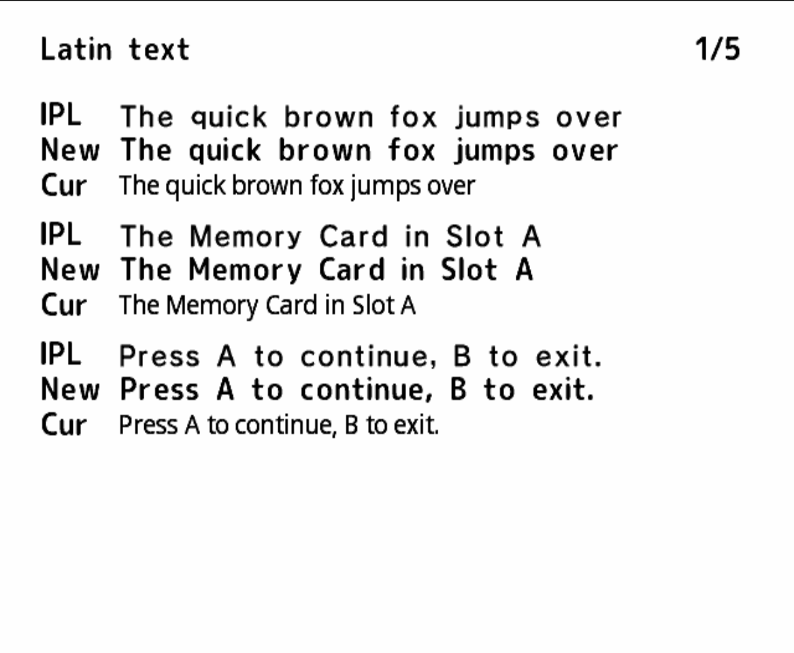
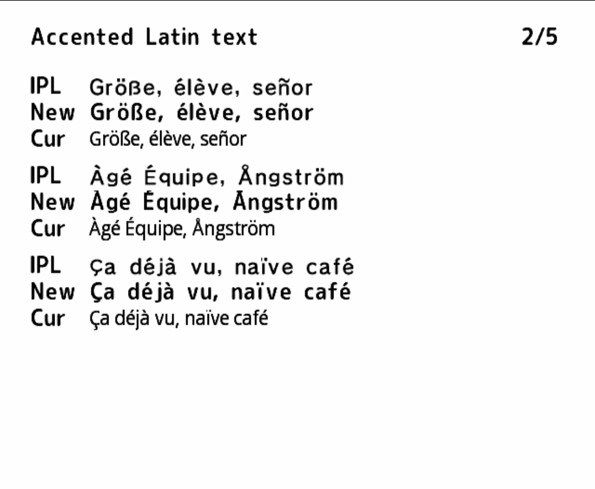
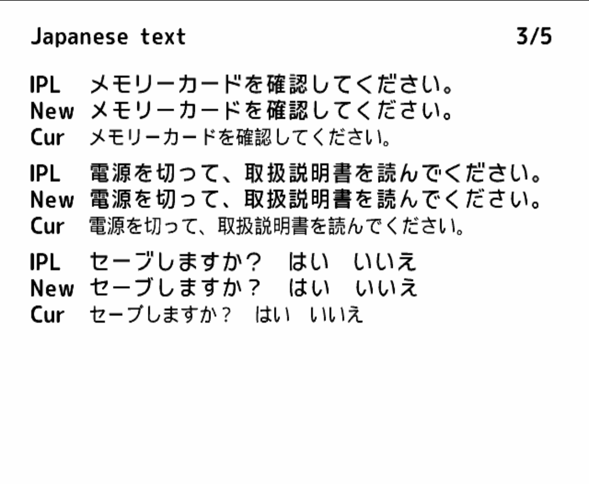
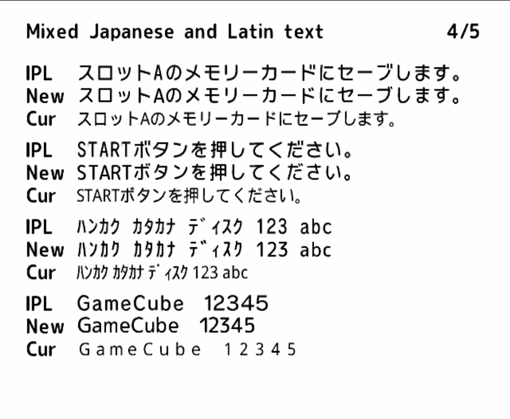
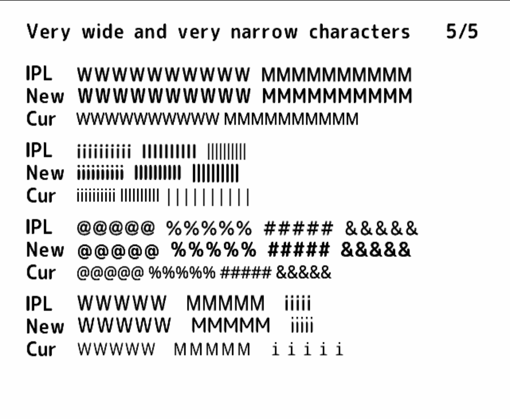

## Examples

The first two rows are Star Fox: Assault, where the current font runs words together in radio messages and menu help. The third row is the memory card dialog in Sonic Mega Collection, where the current font leaves the lines short and cramped. The fourth row is the Double Dash Bonus Disc, where the button icons land between words as with the IPL fonts instead of covering them. The last row is CleanRip, whose text and buttons match the original widths.

| IPL | Proposed | Current |
|---|---|---|
| 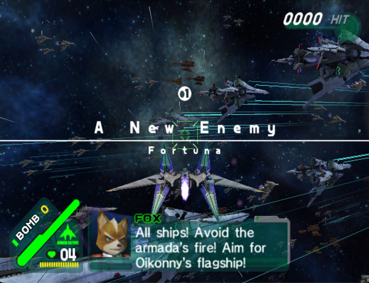 | 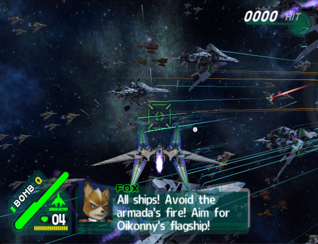 | 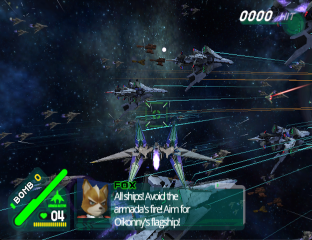 |
| 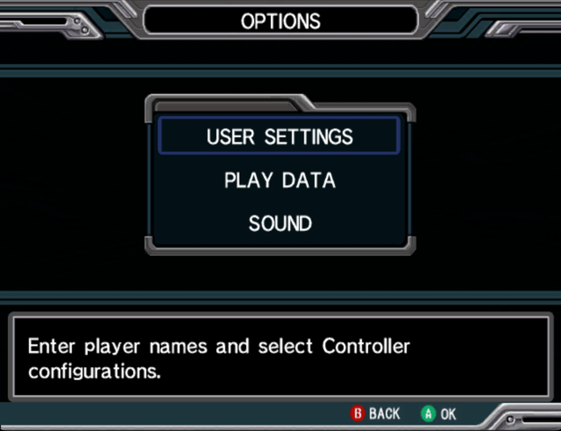 | 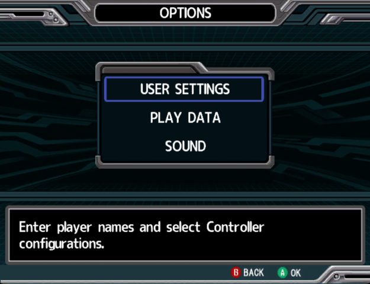 | 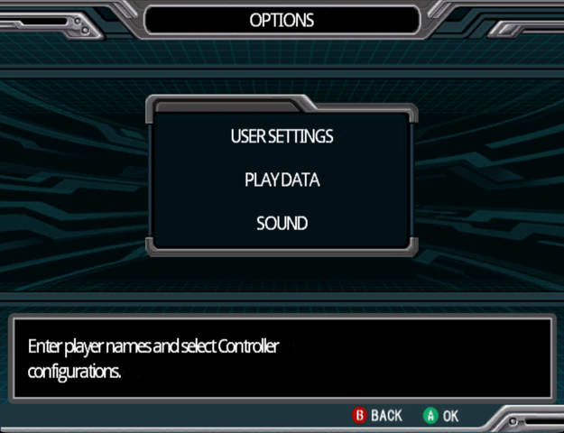 |
| 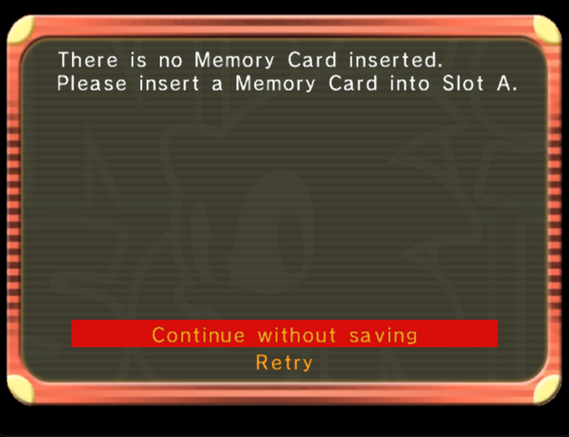 | 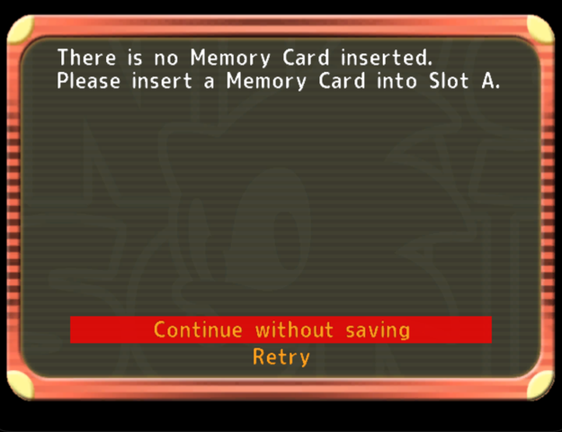 | 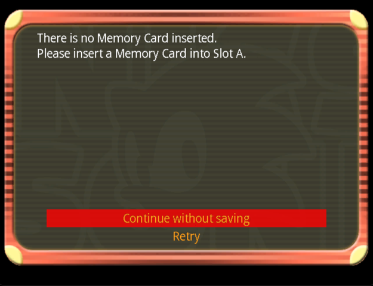 |
| 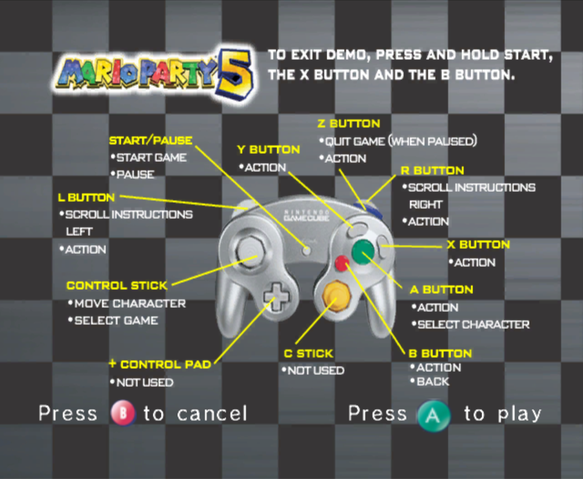 | 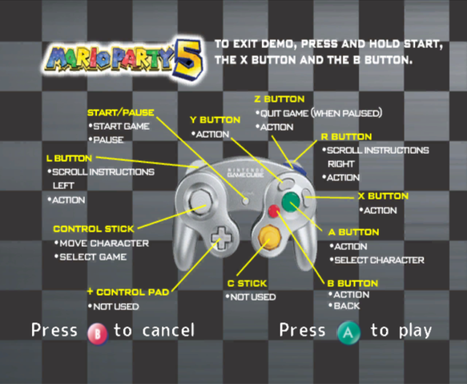 | 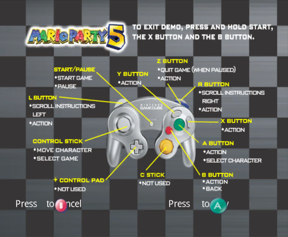 |
| 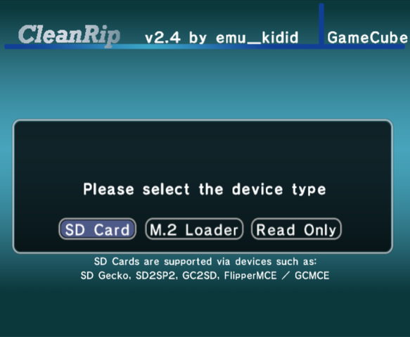 | 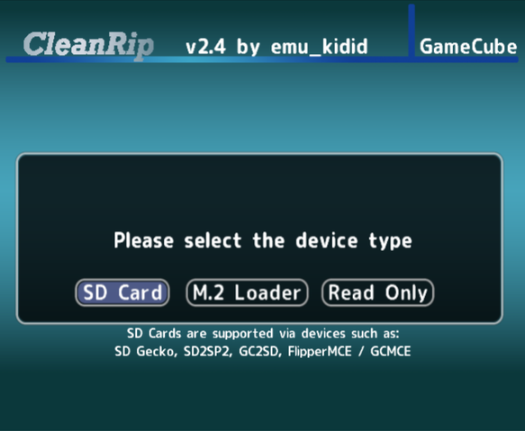 | 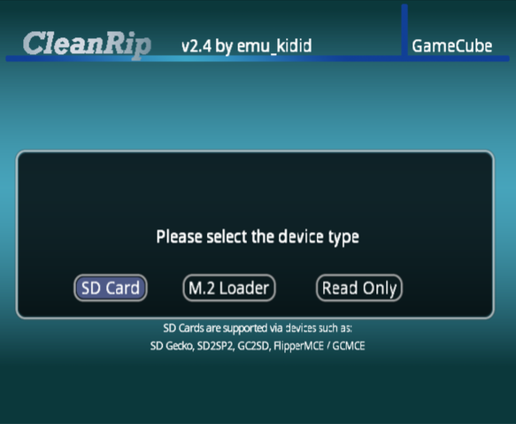 |

## Licenses

- The patched gc-font-tool and its patch come from Dolphin, under the GPL 2.0 or later.
- The M PLUS Rounded 1c fonts, and every font generated from them, are under the SIL Open Font License 1.1.
- homebrew/data/current_*.bin are Dolphin's current fonts, based on Droid Sans under the Apache License 2.0.

The full texts are in [licenses/](licenses)
